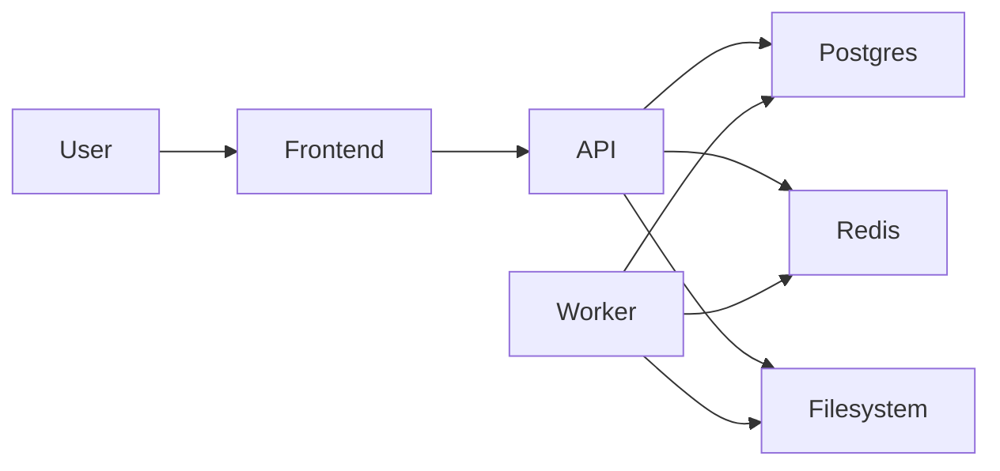

# Tidyscribe

Tidyscribe is a self-hosted document productivity application that turns AI-generated content into polished technical documents. It supports smart paste ingestion, markdown editing, diagram rendering, live previews, and export pipelines for Markdown, HTML, DOCX, and PDF.

## Stack

- Frontend: Next.js 16 + TypeScript + Tailwind, markdown source editor (textarea), `marked` + DOMPurify preview, Mermaid
- Backend: FastAPI + SQLAlchemy with Alembic migrations; Celery + Redis for exports
- Exports: `markdown-it-py` parser feeding HTML, `python-docx` (DOCX) and PDF writers (ReportLab, with WeasyPrint/Pango for RTL text), DejaVu fonts
- Persistence: PostgreSQL + local filesystem volumes
- Deployment: Docker Compose (postgres, redis, backend, export worker, maintenance worker, scheduler, frontend)

Repository: [Debashish-Mukherjee/Tidyscribe](https://github.com/Debashish-Mukherjee/Tidyscribe)

## Documentation

- [docs/api.md](docs/api.md) - REST API reference
- [docs/architecture.md](docs/architecture.md) - modules, export pipeline, frontend structure
- [docs/deployment.md](docs/deployment.md) - running, configuration, logging, backups
- [docs/development.md](docs/development.md) - local setup, tests, conventions
- [docs/roadmap.md](docs/roadmap.md) - what is done and what is next
- [docs/conversion.md](docs/conversion.md) - supported constructs and format limitations
- [docs/validation.md](docs/validation.md) - current validation results and historical findings
- [docs/dependency-maintenance.md](docs/dependency-maintenance.md) - runtime/test boundaries and repeatable audits

## Quick start

```bash
docker compose up -d
```

Then open:

- Frontend: http://localhost:3000
- API docs: http://localhost:8000/docs

## Storage strategy

This V1 release does not use MinIO, S3, or any object storage layer.
Files are stored on local Docker volumes mounted inside the application containers.

Files are persisted under:

- /app/data/uploads
- /app/data/exports
- /app/data/previews
- /app/data/diagrams
- /app/data/templates
- /app/data/generated

## Progress checklist

Done:

- [x] Markdown editor with live preview (headings, tables, task lists, code, callouts, Mermaid, ASCII diagrams)
- [x] HTML, DOCX and PDF export with real structure; diagrams embedded as images; Unicode PDF text with an embedded CJK font (WenQuanYi Micro Hei); shaped Arabic and Hebrew with bidirectional layout
- [x] Smart paste and AI-preamble cleanup / tone transforms
- [x] Rich paste: formatted text copied from chat UIs, Google Docs, Word or web pages arrives as Markdown (bullets, headings, bold, links, tables, code); Ctrl+Shift+V pastes plain text
- [x] Local UTF-8 Markdown, text and HTML file import (up to 2 MB), with HTML conversion and unsaved-work protection
- [x] Diagram conversion: ASCII to Mermaid/SVG/Draw.io; PlantUML (sequence, class, state, activity, component), Draw.io files, Terraform and Kubernetes to Mermaid
- [x] Editor find/replace (Ctrl+F, regex, match case) and a Rich (TipTap) editing mode that round-trips Markdown
- [x] Runtime-configurable API URL (`API_URL`), Prometheus `/metrics`, optional Sentry error tracking
- [x] Optional Pandoc / LibreOffice / Mermaid CLI export pipeline with automatic fallback to the built-in writers
- [x] REST CRUD with soft delete: documents (+ version history), templates, snippets (search, tags, favourite, archive), clipboard history (pin, restore, 100-item cap), settings
- [x] Built-in templates and snippets (seeded at startup)
- [x] Dark / light / system theme (persisted), resizable persisted panes, undo/redo, draft autosave
- [x] Structured JSON logging with request IDs; health and readiness endpoints; OpenAPI docs
- [x] Alembic migrations applied at startup; exports built by the Celery worker with job polling
- [x] Production frontend image; settings screen (theme and default writing style saved server-side)
- [x] Backend tests (pytest, isolated test database), frontend component tests (Vitest) and end-to-end tests (Playwright)
- [x] Documentation: API, architecture, deployment, development, roadmap

Deferred by request: CI/CD pipelines and security (authentication, RBAC, rate limiting, security headers).

Remaining (from the original specification):

- [ ] Colour emoji in PDFs (emoji are currently dropped rather than rendered)
- [x] Retention for old export files (seven days by default); job metadata is retained
- [ ] PlantUML use-case diagrams; Markdown-aware syntax highlighting in the editors

Optional extras: set `INSTALL_DOC_TOOLS=true` and `EXPORT_ENGINE=pandoc` to build DOCX with Pandoc and PDF with LibreOffice, with server-side Mermaid rendering; set `SENTRY_DSN` for error tracking. See [docs/deployment.md](docs/deployment.md).

## Architecture summary



## Project origins

The original specification is preserved in `converter-prompt.docx` and `converter_prompt_extracted.txt` under the former name, AI Document Workbench. Tidyscribe retains the existing database identifiers and browser storage keys for compatibility.
