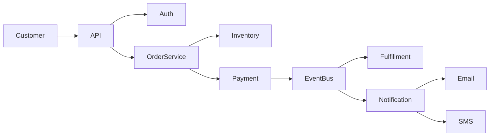
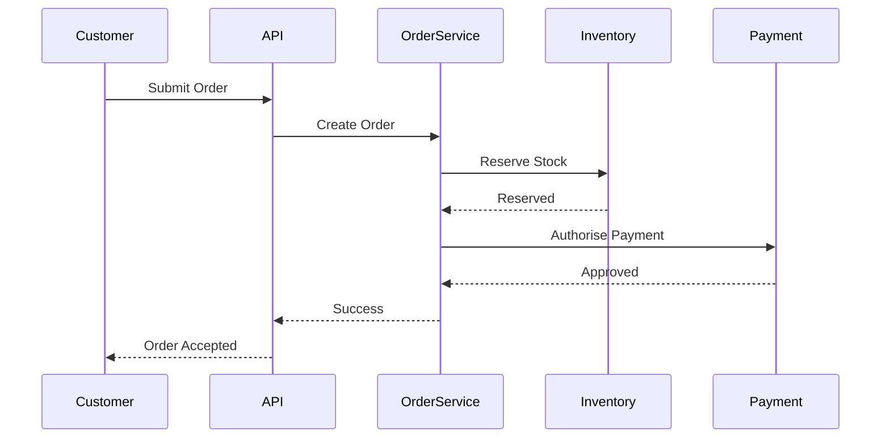

# Order Processing Platform

## Executive Summary

The Order Processing Platform enables customers to place orders through multiple channels while ensuring secure validation, inventory reservation, and asynchronous fulfillment.

### Objectives

- Improve order processing speed
- Reduce manual intervention
- Support horizontal scaling
- Enable near real-time status tracking

---

## Key Requirements

| Requirement | Priority | Status |
|-------------|----------|--------|
| Order Capture | High | Approved |
| Payment Validation | High | Approved |
| Inventory Check | High | Approved |
| Notifications | Medium | Approved |
| Reporting | Low | Planned |

---

## Architecture Overview



---

## Component Description

### API Gateway

Responsible for:

- Authentication
- Rate limiting
- Routing
- Request validation

### Order Service

Responsible for:

- Order creation
- Tracking status
- Publishing events

### Inventory Service

Responsible for:

- Stock validation
- Reservation management

---

## Sequence Diagram



---

## Risks

> Inventory synchronization may become inconsistent during network partitions.

> Event processing delays may impact customer notifications.

### Mitigations

- Use idempotent consumers
- Retry failed message processing
- Implement circuit breakers

---

## Implementation Tasks

- [x] Define APIs
- [x] Create database schema
- [ ] Implement event processing
- [ ] Build dashboard
- [ ] Load testing

---

## ASCII Diagram

+-------------+
| API Gateway |
+-------------+
       |
       v
+-------------+
| Order API   |
+-------------+
       |
       v
+-------------+
| Event Bus   |
+-------------+
       |
       v
+-------------+
| Fulfillment |
+-------------+

---

## Sample Code

```python
class OrderProcessor:
    def process(self, order):
        if not order:
            raise ValueError("Order required")

        return {
            "status": "accepted",
            "order_id": order["id"]
        }
```

---

## Configuration

```yaml
application:
  name: order-platform

database:
  host: postgres
  port: 5432

redis:
  host: redis
  port: 6379
```

---

## Important Notes

> [!WARNING]
> Payment processing requires PCI compliant environments.

> [!TIP]
> Use asynchronous processing wherever possible.

---

## References

- https://www.postgresql.org
- https://redis.io
- https://fastapi.tiangolo.com
- https://pandoc.org

---
