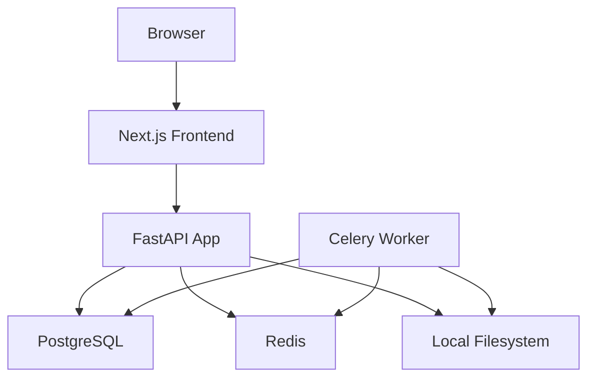
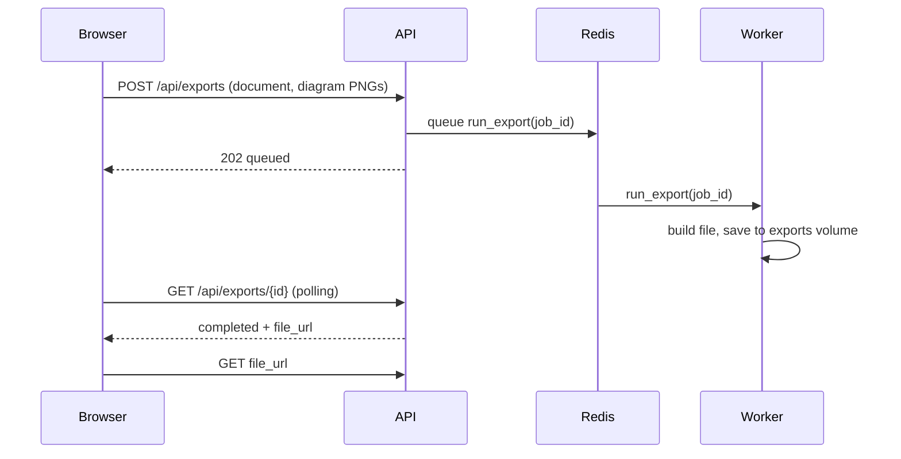
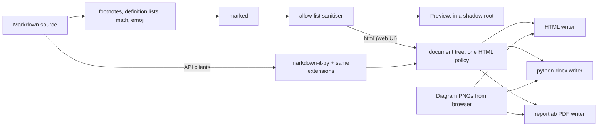
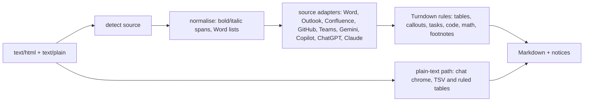

# Architecture

## Overview

The application uses a modular monolith in the backend and a single Next.js frontend. The architecture separates concerns into API, editor, transforms, exports, document storage, and job orchestration layers while keeping the deployment simple for local self-hosting.



## Principles

- Keep the backend modular but monolithic.
- Provide APIs for every feature.
- Prefer simple production-ready defaults.
- Prefer local filesystem storage over object storage in V1.
- Use Docker volumes for uploads, exports, previews, templates, and generated files.
- Long-running work (exports) runs in Celery workers; the API only validates, queues and reports status.

## Backend modules

```text
backend/app/
  main.py              app wiring, health, transform, parse-paste, exports
  api/                 one router per resource: documents, templates, snippets, clipboard, settings, diagrams
  services/
    export_service.py  markdown -> HTML / DOCX / PDF (built-in writers)
    export_pipeline.py export entry point: server-side Mermaid, optional Pandoc/LibreOffice engine, fallback
    cli_pipeline.py    subprocess wrappers for pandoc, soffice, mmdc
    diagram_service.py ASCII -> Mermaid/SVG/Draw.io, PlantUML -> Mermaid, format detection
    plantuml_extra.py  PlantUML activity and component diagrams
    drawio_import.py   Draw.io XML -> Mermaid
    infra_diagrams.py  Terraform and Kubernetes -> Mermaid
    parser_service.py  smart paste detection and normalisation
    transform_service.py AI cleanup and tone transforms
  logging_config.py    JSON logging and request-ID middleware
  metrics.py           Prometheus metrics and /metrics
  error_tracking.py    optional Sentry
  migrations.py        runs Alembic at startup (adopts pre-Alembic databases)
  tasks.py             Celery app and the run_export task
  seed.py              built-in templates and snippets
```

Request handlers get a database session through FastAPI `Depends(get_db)`, which closes it when the request ends.

## Export pipeline

The API validates the request, stores any uploaded diagram images on the shared volume and queues a Celery task; the worker builds the file and records the result on the job row, which the browser polls.



One document tree feeds three writers, so all formats agree on structure. The tree is built from **HTML**, and the HTML
comes from the Preview whenever the browser has one (the web UI sends it with every export), so what the user saw is what
is exported. API-only clients send Markdown and get the same tree from the server's Markdown renderer.



`frontend/lib/preview.ts` + `markdown-ext.ts` and `backend/app/services/doc_tree.py` implement one Markdown dialect:
GFM, callouts (`> [!NOTE]`), task lists, footnotes (`[^1]`), definition lists, `:emoji:` shortcodes from one shared table
(`backend/app/data/emoji.json`, copied to `frontend/lib/emoji-map.json`), and math as `$x$`, `$$x$$`, `\(x\)`, `\[x\]`
(markdown-it-dollarmath rules: no space inside the delimiters, no digit outside them, so `$5 and $10` stays text).
Math is KaTeX MathML in the Preview and in the HTML export (via latex2mathml); DOCX and PDF carry it as readable Unicode
(`math_text.py`), because neither format can typeset TeX.

### One raw-HTML policy

Pasted and AI-written Markdown contains raw HTML. The product keeps a safe, document-semantic subset **everywhere** and
removes the rest (its text is kept, and the Preview says what was removed):

- Kept: headings, paragraphs, lists, tables (including `colspan`, `rowspan`, `align`, lists and code inside cells),
  `details`/`summary`, `kbd`, `sub`, `sup`, `mark`, `u`, `ins`, `del`, `small`, `abbr`, `q`, `br`, `hr`, `pre`/`code`, links with
  `http(s)`, `mailto`, `tel` addresses, MathML.
- Removed: scripts, styles, forms and controls, frames, embeds, SVG, inline `style` and event attributes, any other tag.

The lists live in `frontend/lib/sanitize.ts` (DOMPurify `ALLOWED_TAGS`) and `backend/app/services/html_policy.py`
(consumed by the tree builder); `frontend/tests/unit/markdown-ext.test.ts` fails if they drift. Images are shown in the
Preview; the exports include their alt text (embedding remote images is not done).

### Import pipeline (clipboard to Markdown)



Everything lives in `frontend/lib/import/` (`richpaste.ts` is the public facade). Adapters only act on markup that is
unmistakably their tool's (a Copy button, a Skype microdata attribute, a Confluence macro class) and every change is
returned as a notice that the status bar shows. Tables become pipe tables when Markdown can express them and HTML tables
(same policy as above) when it cannot (merged cells, lists, code or nested tables in cells).

Fixtures for every source are in `test-fixtures/imports/` with their expectations in `manifest.json`; the unit tests
(`import-fixtures.test.ts`) and the browser tests (`tests/e2e/fidelity.spec.ts`) read the same files.

### Clean AI Text

`backend/app/services/cleaning.py` is a list of named rules (speaker labels, openers and lead-ins, closers, AI
self-references, citation markers, Copy-code bars, whitespace). Each reports what it changed; fenced code is never
edited. `POST /api/transform` returns the cleaned text and the report, the editor shows it in a review dialog, and nothing
changes until the user applies it. Smart Paste uses the same rules.

Mermaid diagrams are rendered by the browser (no headless browser on the server) and uploaded as PNGs keyed by their Mermaid source; the writers embed the matching image or fall back to the source text.

## Frontend structure

```text
frontend/
  components/workbench.tsx       page shell: header (title, save state, Save, Export menu), editor tools, preview tabs, status bar
  components/export-menu.tsx     Export split menu (DOCX, PDF, HTML, Markdown)
  components/ui.ts               shared button and select styles (one solid-blue primary per view)
  components/sidebar-panels.tsx  documents, templates, snippets, clipboard panels (CRUD)
  components/resizable.tsx       drag/keyboard resize handle
  lib/api.ts                     typed REST client
  lib/diagrams.ts                Mermaid rendering to PNG, diagram range detection
  lib/theme.ts                   dark/light/system theme, persisted
  lib/history.ts                 undo/redo reducer
  lib/richpaste.ts               clipboard HTML to Markdown (Turndown + GFM) on paste
```

The editor is a plain markdown textarea; the preview is `marked` output sanitised with DOMPurify. Layout, theme and draft are stored in `localStorage`.
