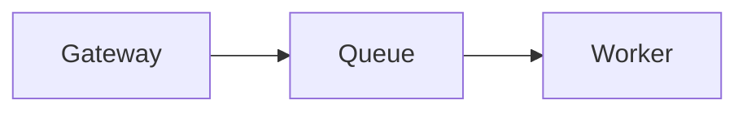

# Order Platform

## Architecture

The **gateway** accepts `POST /orders` and queues work.

> [!NOTE]
> Delivery is at least once.

- [x] Validate request
- [ ] Complete review

| Component | Responsibility |
| --- | --- |
| Gateway | Accept requests |
| Worker | Process orders |

```python
print("order accepted")
```



Latency is $x^2$.[^1]

[^1]: Measured in the test environment.

<details><summary>Operations</summary><p>Restart the worker safely.</p></details>

<table><tr><th colspan="2">Service ownership</th></tr><tr><td>Orders</td><td>Platform team</td></tr></table>
