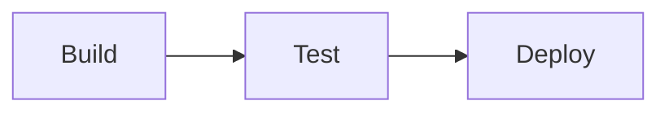

# Release Plan

> [!WARNING]
> Freeze starts Friday at 17:00.

## Checklist

- [x] Code freeze
- [ ] Smoke tests
- [ ] Announce

## Environments

| Env | URL | Owner |
|-----|-----|:-----:|
| Staging | https://staging.example.com | Ada |
| Prod | https://example.com | Bob |

## Keys

Press <kbd>Ctrl</kbd>+<kbd>S</kbd> to save. Water is H<sub>2</sub>O.

<details>
<summary>Rollback steps</summary>

1. Revert the **deployment**
2. Restore the snapshot

</details>

## Flow



```python
def release(version: str) -> bool:
    return version.startswith("v")
```

Read the [runbook](https://example.com/runbook) first.
